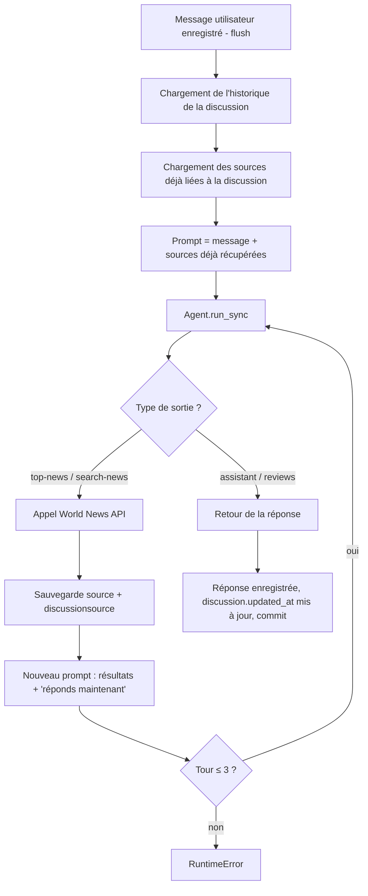

# NewsFoundry : Backend

API FastAPI (Python 3.13, `uv`) : authentification JWT, discussions, messages, revues de presse et agent IA.

## Sommaire

- [Installation et lancement](#installation-et-lancement)
- [Structure du code](#structure-du-code)
- [API](#api)
- [Base de données](#base-de-données)
- [Fonctionnement de l'IA](#fonctionnement-de-lia)
- [Reprise des conversations](#reprise-des-conversations)
- [Tests](#tests)
- [Limites connues](#limites-connues)

## Installation et lancement

```bash
cp .env.example .env     # renseigner JWT_SECRET_KEY, AI_MODEL, MAMMOUTH_KEY, API_KEY_WORLD
uv sync                  # CI : uv sync --locked

docker run --name newsfoundry_db \
  -e POSTGRES_USER=user -e POSTGRES_PASSWORD=password -e POSTGRES_DB=newsfoundry \
  -p 5432:5432 -d postgres:17

uv run --env-file .env src/main.py
```

- API : `http://localhost:8000`, documentation interactive : `/docs`.
- `init_db()` (création des tables avec `SQLModel.metadata.create_all`) n'est appelé que dans le bloc `__main__` de `src/main.py`. Si vous lancez l'application autrement (`uvicorn main:app`), les tables ne sont pas créées. Il n'y a **pas de système de migration** : un changement de modèle sur une base existante demande une intervention manuelle.
- Les variables d'environnement sont détaillées dans le [README racine](../README.md#variables-denvironnement).
- Image Docker : à construire depuis la **racine du dépôt** (`docker build -f backend/Dockerfile -t newsfoundry-api .`).
- Production : service **Railway** (builder Dockerfile via `railway.json`) avec un service **PostgreSQL** Railway. Variables, domaine public et vérifications : [README racine → Déploiement](../README.md#déploiement).

### Mode sans clé (`AI_MODEL=test`)

C'est la valeur par défaut. Un `TestModel` PydanticAI renvoie toujours la même revue de démonstration : aucun appel réseau, aucune clé, aucun coût. Toute autre valeur d'`AI_MODEL` active le vrai modèle.

### S'authentifier dans Swagger (`/docs`)

1. `POST /auth/register` puis `POST /auth/login` avec `{"email": "...", "password": "..."}` ; copier `access_token`.
2. Bouton **Authorize** : coller le jeton **sans** le préfixe `Bearer`.

## Structure du code

```text
backend/
├── src/
│   ├── main.py               # App FastAPI, CORS, gestion IntegrityError (409), démarrage
│   ├── database.py           # Engine SQLModel, init_db()
│   ├── models.py             # Tables SQLModel
│   ├── routers/
│   │   ├── base.py           # Auth, discussions, messages, revues de presse
│   │   └── chat.py           # Route /chats : stub, non utilisée par le frontend
│   └── lib/
│       ├── callModele.py     # Agent IA, appel World News API, stockage des sources
│       └── prompt_systeme.py # Prompt système de l'agent
└── tests/
    ├── conftest.py           # Variables d'environnement de test, sys.path
    ├── test_api.py           # Tests des endpoints (FastAPI TestClient)
    └── test_call_modele.py   # Tests de la logique IA (sans réseau)
```

## API

Toutes les routes, sauf `/`, `/auth/register` et `/auth/login`, exigent `Authorization: Bearer <token>`.

| Méthode | Route | Fonction |
| --- | --- | --- |
| `GET` | `/` | Santé de l'API |
| `POST` | `/auth/register` | Créer un compte (email normalisé en minuscules, mot de passe 8 à 72 octets) |
| `POST` | `/auth/login` | Obtenir un JWT |
| `GET` | `/auth/me` | Compte courant |
| `GET`, `POST` | `/discussions` | Lister (triées par `updated_at` décroissant) ou créer |
| `GET`, `PATCH`, `DELETE` | `/discussions/{id}` | Lire, renommer, supprimer (supprime aussi messages et revues) |
| `GET` | `/discussions/{id}/messages` | Historique ordonné par date puis id |
| `POST` | `/discussions/{id}/messages` | Envoie un message **et renvoie `[message_utilisateur, réponse_ia]`** |
| `PATCH`, `DELETE` | `/discussions/{id}/messages/{message_id}` | Modifier ou supprimer un message |
| `POST` | `/discussions/{id}/press-reviews` | Crée une revue à partir de la dernière réponse `reviews` (`409` s'il n'y en a pas) |
| `GET` | `/press-reviews` | Lister ses revues (plus récentes d'abord) |
| `GET`, `PATCH`, `DELETE` | `/press-reviews/{id}` | Lire, modifier, supprimer |
| `POST` | `/chats?prompt=...` | Stub : renvoie `{"content": "message reçu"}` |

Codes d'erreur : `401` jeton absent/invalide ou identifiants incorrects, `404` ressource inexistante **ou appartenant à un autre utilisateur**, `409` email déjà utilisé ou revue demandée sans réponse `reviews` dans la discussion, `422` validation, `429` quota du modèle IA atteint, `502` panne ou réponse illisible du modèle / de World News API (ou erreur inattendue), `503` `JWT_SECRET_KEY` non configuré, `504` World News API trop lente. En cas d'échec de l'IA, le message utilisateur n'est pas conservé.

## Base de données

SQLModel/SQLAlchemy. PostgreSQL en usage normal ; SQLite si `DATABASE_URL` n'est pas défini (et pour les tests). Les dates sont stockées en UTC.

```text
user ──< discussion ──< message
  │          │
  │          ├──< pressreview >── user
  │          │
  │          └──< discussionsource >── source
```

| Table | Colonnes principales | Rôle |
| --- | --- | --- |
| `user` | `id`, `email` (unique), `hashed_password` (bcrypt), `created_at` | Comptes |
| `discussion` | `id`, `owner_id` → user, `title` (≤ 200), `created_at`, `updated_at` | Conversation d'un utilisateur ; `updated_at` est mis à jour à chaque échange |
| `message` | `id`, `discussion_id` → discussion, `role`, `content`, `created_at` | Un message de la conversation |
| `pressreview` | `id`, `owner_id`, `discussion_id`, `title`, `content`, `created_at` | Revue enregistrée (copie du texte de la réponse IA) |
| `source` | `id`, `url` (indexée), `content`, `created_at` | Un article récupéré (`content` = texte intégral de l'article) |
| `discussionsource` | `discussion_id`, `source_id` (clé primaire composite) | Lien N-N entre discussions et sources, `ON DELETE CASCADE` |

Points importants :

- **`message.role`** vaut `user`, `assistant` (réponse textuelle) ou `reviews` (réponse mise en forme de revue de presse). Ce rôle permet au frontend de styler le message et au backend de retrouver la dernière revue.
- **Une revue est une copie** : modifier ou supprimer le message `reviews` d'origine ne change pas la `pressreview`, et inversement.
- **Les sources sont dédoublonnées par URL** : un article déjà connu n'est pas recréé, il est simplement relié à la discussion. La table `source` n'a pas de propriétaire ; l'isolation passe par `discussionsource` et la discussion, elle-même filtrée par `owner_id`.
- **Suppression d'une discussion** : le code supprime ses messages et ses revues ; les liens `discussionsource` sont supprimés par la cascade de la clé étrangère (effective sous PostgreSQL ; SQLite n'applique pas les clés étrangères par défaut). Les lignes `source` restent, elles peuvent servir à d'autres discussions.
- **Contrôle d'accès** : `get_owned_discussion()` (`routers/base.py`) filtre sur `owner_id` pour toute lecture ou écriture liée à une discussion ; les revues sont filtrées sur `owner_id` dans chaque requête.
- **Mots de passe** : hachés avec bcrypt (limite de 72 octets validée à l'inscription). Jamais stockés ni renvoyés en clair.

## Fonctionnement de l'IA

Tout est dans `src/lib/callModele.py`, avec le prompt dans `src/lib/prompt_systeme.py`.

### Composants

- **Modèle** (`build_model`) : `OpenAIChatModel("mammouth-recommended")` via `https://api.mammouth.ai/v1` (API compatible OpenAI, clé `MAMMOUTH_KEY`), ou `TestModel` si `AI_MODEL=test`.
- **Agent** (`chat_agent`) : agent PydanticAI avec le prompt système `PROMPT_SYSTEME_BASE` et une **sortie structurée** qui est l'une de ces trois formes :

| Sortie (`kind`) | Signification | Traitement par le backend |
| --- | --- | --- |
| `assistant` | Réponse texte (question de clarification, aperçu, refus hors périmètre…) | Renvoyée à l'utilisateur, stockée avec `role="assistant"` |
| `reviews` | Revue de presse complète au format imposé | Renvoyée, stockée avec `role="reviews"` |
| `top-news` | Demande des meilleures actualités d'un pays/langue/date | Appel World News API `/top-news` |
| `search-news` | Recherche filtrée (texte, dates, pays, catégories…) | Appel World News API `/search-news` |

Les paramètres de ces appels (`ParamsTopNews`, `ParamsSearchNews`) sont des modèles Pydantic validés : par exemple `source-country` et `language` doivent être deux lettres minuscules, `max-news-per-cluster` est borné de 1 à 10. Le modèle ne peut donc pas lancer un appel mal formé.

### Prompt système

`PROMPT_SYSTEME_BASE` impose notamment :

- le rôle (assistant de revue de presse) et le **périmètre** (actualité, rédaction de revue, déontologie ; refus poli du reste) ;
- de répondre dans la langue de l'utilisateur ;
- **un seul type de sortie par tour** et les règles de choix entre `assistant`, `reviews`, `top-news` et `search-news` ;
- de ne **jamais inventer** d'actualité absente des données reçues ;
- de poser une question plutôt que d'appeler l'API si pays ou langue manquent, ou sont incompatibles ;
- le format strict de la revue (titre, introduction, puces, ligne `Sources`).

**Date du jour** : `instruction_date_du_jour()` (`lib/prompt_systeme.py`) ajoute à chaque appel une instruction du type « Date du jour : lundi 16 novembre 2026 (2026-11-16) ». Elle est recalculée à chaque exécution, ce qui permet au modèle d'interpréter « hier » ou « cette semaine » et de dater la revue. Le fuseau est `Europe/Paris` par défaut, modifiable avec `APP_TIMEZONE` (repli sur UTC si la base de fuseaux est absente).

**Instructions et historique** : le prompt est passé à l'agent via `instructions=` et non `system_prompt=`. PydanticAI ne rejoue pas le `system_prompt` quand un `message_history` est fourni ; le modèle perdrait donc ses règles à partir du 2e message d'une discussion. Les `instructions` sont envoyées à chaque appel. `PROMPT_SYSTEME_WITH_NEWS` (variante où les news sont injectées dans la requête) existe mais n'est pas utilisé.

### Déroulement d'un message (`call_modele_chat`)

`POST /discussions/{id}/messages` appelle `call_modele_chat(prompt, session, discussion_id)` :



Pour que le modèle puisse demander des informations à `World News API`, son type de sortie est strictement défini. Ce type de sortie autorise 4 cas, gérés dans la fonction [`backend/src/lib/callModele.py`](backend/src/lib/callModele.py). Ils sont communiqués au modèle via le prompt système et via le paramètre `output_type` de l'agent PydanticAI :

- **`assistant`** : la réponse est renvoyée directement au front.
- **`reviews`** ou **`top-news`** : un appel à World News API est effectué, puis le modèle est rappelé avec les nouvelles données.
- **`review`** : la réponse est enregistrée en base de données comme revue de presse, puis renvoyée au front, qui sait qu'il s'agit d'une revue de presse et adapte l'affichage.
- **Tout autre type de sortie** : une erreur est levée et un message d'erreur est envoyé au front, qui l'affiche.

1. L'historique est chargé et converti au format PydanticAI.
2. Les sources déjà associées à la discussion sont ajoutées au prompt sous « Données déjà récupérées ».
3. L'agent répond. S'il demande des actualités, `call_world_new` interroge `https://api.worldnewsapi.com/{top-news|search-news}` (en-tête `x-api-key`, timeout 50 s), la réponse est validée par Pydantic (`parse_response`), les articles sont enregistrés (`save_article`) puis renvoyés au modèle avec l'instruction de conclure sans rappeler l'API.
4. **Maximum 3 tours** (`MAX_NEWS_ROUNDS`). Au-delà, une `RuntimeError` est levée.
5. La dernière réponse (`assistant` ou `reviews`) est stockée comme message.
6. Si une étape échoue (modèle, World News API, limite de 3 tours), l'exception est journalisée, la transaction annulée, le message utilisateur retiré et l'API répond suivant l'érreur.

## Erreurs HTTP renvoyées par le service de chat

Les fonctions `call_modele_chat` et `call_world_new` lèvent des `HTTPException`
lorsqu'un service externe (modèle IA ou World News API) échoue. `create_message`
(`routers/base.py`) les **relance telles quelles** après rollback et suppression
du message utilisateur : le statut et le `detail` arrivent donc au client sans
être réécrits. Toute autre exception tombe dans le filet de sécurité du routeur,
qui répond `502` avec un message générique. Le détail technique (code d'origine,
message) reste dans les logs ; le corps de la réponse amont n'est jamais renvoyé.

### Erreurs liées au modèle IA (`call_modele_chat`)

| Code | Nom | Message (`detail`) | Cause | Action côté client |
|------|-----|--------------------|-------|--------------------|
| 429 | Too Many Requests | Limite de requêtes du modèle IA atteinte | Le fournisseur du modèle a renvoyé un 429 (quota dépassé) | Réessayer plus tard |
| 502 | Bad Gateway | Erreur du service du modèle IA | Le fournisseur a renvoyé une autre erreur HTTP (dont 401 : clé API du serveur invalide, 5xx : panne) | Réessayer plus tard ; si persistant, contacter l'administrateur |
| 502 | Bad Gateway | Réponse invalide du modèle IA | Le modèle a produit une sortie inexploitable (`UnexpectedModelBehavior`, dont `ContentFilterError`) | Reformuler la demande ou réessayer |

### Erreurs liées à World News API (`call_world_new`)

| Code | Nom | Message (`detail`) | Cause | Action côté client |
|------|-----|--------------------|-------|--------------------|
| 504 | Gateway Timeout | World News API met trop de temps à répondre | Aucune réponse dans le délai de 50 s (`requests.Timeout`) | Réessayer plus tard |
| 502 | Bad Gateway | Erreur de World News API | L'API a renvoyé un statut 4xx/5xx (dont 401 : clé API du serveur invalide) | Réessayer plus tard ; si persistant, contacter l'administrateur |
| 502 | Bad Gateway | World News API injoignable | Erreur réseau (DNS, connexion refusée, etc.) **ou réponse non JSON** : `requests.RequestException`, dont `JSONDecodeError` levé par `res.json()` | Réessayer plus tard |

### Erreurs non prévues (filet de sécurité de `create_message`)

| Code | Nom | Message (`detail`) | Cause | Action côté client |
|------|-----|--------------------|-------|--------------------|
| 502 | Bad Gateway | L’assistant n’a pas pu répondre pour le moment. Réessayez dans un instant. | Erreur réseau vers le modèle (`ModelConnectionError`, `ModelTimeoutError`), `ValidationError` de `parse_response`, boucle de news dépassée (`RuntimeError` après `MAX_NEWS_ROUNDS`), erreur SQL ou bug inattendu | Réessayer plus tard ; si persistant, contacter l'administrateur |

### Remarques

- **Rôle de chaque couche :** `call_modele_chat` et `call_world_new` choisissent le
  statut ; `create_message` le propage sans le modifier ; le `except Exception`
  du routeur ne concerne que les cas non prévus et renvoie le `502` générique.
- **Un 401 de l'API amont n'est jamais renvoyé tel quel au client.** Il signifie
  que la clé API *du serveur* est invalide, pas que l'utilisateur est mal
  authentifié. Il est converti en 502 et le code d'origine reste visible dans
  les logs.
- **Nettoyage garanti :** en cas d'échec, quel que soit le statut, le message
  utilisateur est retiré (rollback puis suppression de l'orphelin) par le bloc
  `finally` de `create_message`.
- **Distinction 4xx / 5xx :** seul le 429 est de la responsabilité du client
  (volume de requêtes). Toutes les autres erreurs sont de la responsabilité du
  serveur ou de ses dépendances.
- **Aucun retry automatique** n'est effectué : c'est au client de relancer la
  requête.

### « Pseudo RAG » : réutilisation des sources

Il n'y a **pas d'embeddings ni de recherche vectorielle**. Le principe est simple :

- chaque article récupéré est stocké (`source`) et lié à la discussion (`discussionsource`) ;
- à chaque nouveau message, **toutes** les sources de la discussion sont réinjectées en texte dans le prompt ;
- le modèle peut ainsi répondre à une question de suivi (« résume le 2e article », « fais-en une revue ») sans refaire d'appel World News API.

Conséquence : la taille du prompt croît avec le nombre d'articles de la discussion (voir les limites).

## Reprise des conversations

Le modèle n'a pas de mémoire propre : à chaque requête, l'historique est reconstruit depuis la base.

1. **Lecture** : tous les `message` de la discussion, triés par `created_at` puis `id`.
2. **Dédoublonnage** : le message utilisateur courant est déjà en base (flush avant l'appel). S'il est le dernier et identique au prompt, il est retiré de l'historique pour ne pas être envoyé deux fois.
3. **Conversion** (`to_pydantic_history`) : un message `user` devient une `ModelRequest` (`UserPromptPart`) ; tout autre rôle (`assistant`, `reviews`) devient une `ModelResponse` (`TextPart`).
4. **Envoi** : `agent.run_sync(user_prompt=..., message_history=history)`. Pendant la boucle de news, l'historique est remplacé par `run.all_messages()`, afin que le modèle voie sa propre demande et le résultat obtenu.

Ce qui est **persisté** : les messages `user` et la réponse finale `assistant`/`reviews`, ainsi que les articles. Ce qui ne l'est pas : les échanges intermédiaires avec l'API de news (le modèle demande des news, reçoit les articles) ; ils sont reconstruits au tour suivant via les sources de la discussion.

## Tests

```bash
uv run pytest -q                             # tous les tests (24)
uv run pytest tests/test_call_modele.py -q   # logique IA seule
uv run pytest tests/test_api.py -q           # endpoints seuls
uv run pytest -k isolated -q                 # un test par nom
uv run ruff check src tests                  # lint
```

- Base **SQLite en mémoire** (`StaticPool`), recréée à chaque test : PostgreSQL n'est pas nécessaire.
- `tests/conftest.py` force `AI_MODEL=test`, `API_KEY_WORLD=test-key`, `MAMMOUTH_KEY=""` et un `JWT_SECRET_KEY` de test ; ils sont définis avant l'import de l'application et ne dépendent donc pas de votre `.env`.
- `test_call_modele.py` bloque tout accès réseau (`requests` et `socket`) : un appel réel fait échouer le test. `call_modele_chat` accepte `agent=` et `fetch_world_news=` pour injecter de faux objets.

| Fichier | Couverture |
| --- | --- |
| `test_api.py` | inscription/connexion, cycle discussion → message → revue, isolation entre utilisateurs, authentification requise, `409` sans revue, `502` si l'IA échoue |
| `test_call_modele.py` | parsing des réponses World News, construction de la requête HTTP et propagation des erreurs, dédoublonnage des sources, conversion de l'historique, boucle de news (top-news, search-news), limite de 3 tours, date du jour et prompt système présents même avec un historique |

La CI (`.github/workflows/ci.yml`) lance Ruff puis `test_call_modele.py`, puis toute la suite, avec `uv sync --locked`.

## Limites connues

- **Taille du prompt** : toutes les sources d'une discussion sont réinjectées à chaque message ; sur une longue discussion, cela peut dépasser la fenêtre de contexte ou augmenter le coût.
- **Pas de streaming** : la réponse est renvoyée une fois l'agent terminé (appel synchrone, plusieurs secondes possibles).
- **Pas de migrations** (voir plus haut) et pas de limitation de débit sur les routes d'authentification.
